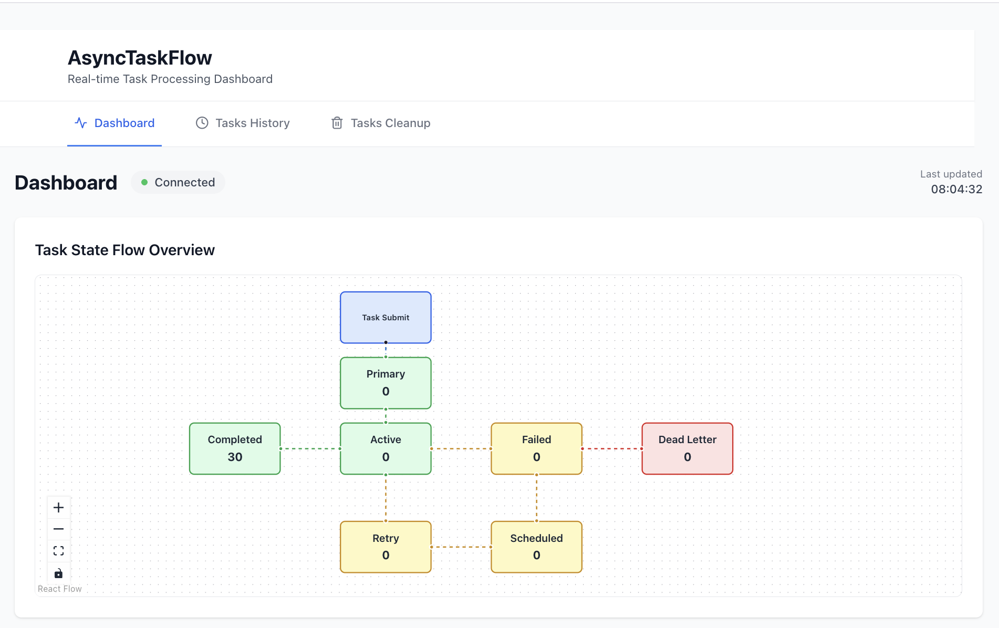
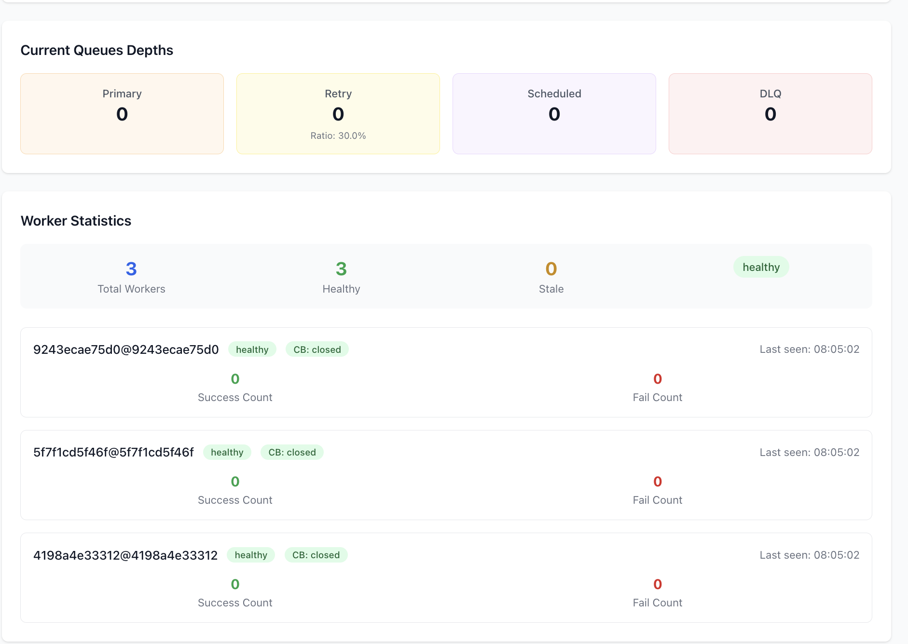
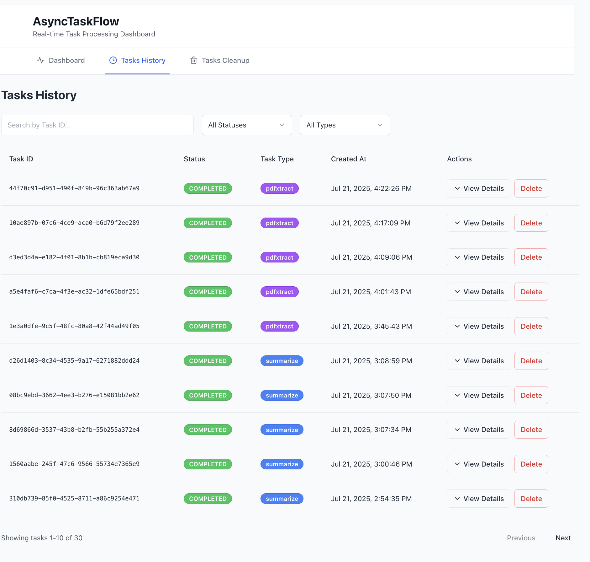
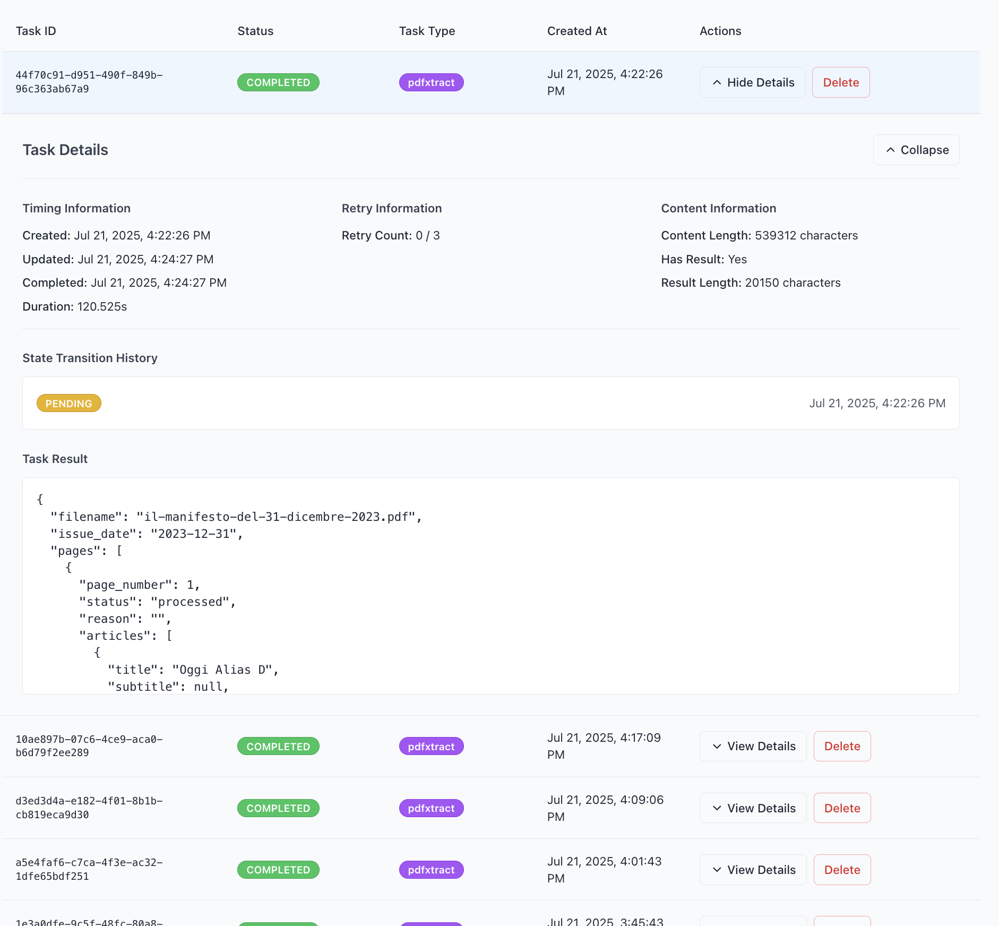
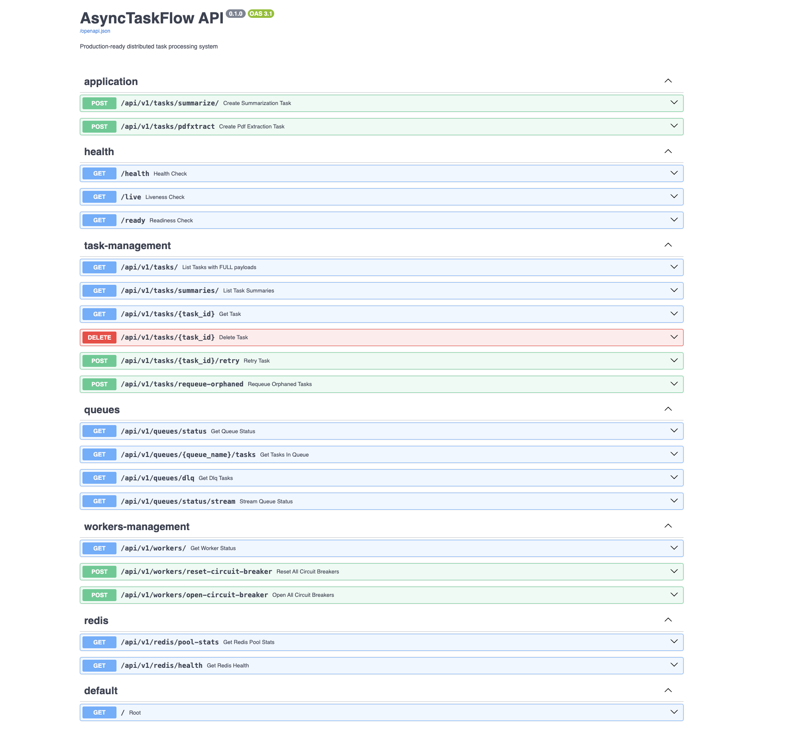

# TaskFlow API

**A production-ready, distributed task processing system built with FastAPI, Python, and Redis and a React/Tailwind frontend**

This project provides a robust framework for handling asynchronous tasks, featuring a sophisticated queueing system, circuit breaker protection, and a comprehensive real-time monitoring dashboard.

[](https://www.python.org/downloads/release/python-311/)
[](https://fastapi.tiangolo.com/)
[](https://docs.celeryq.dev/en/stable/)
[](https://redis.io/)
[](https://reactjs.org/)
[](https://reactflow.dev/)
[](https://tailwindcss.com/)
[](https://www.docker.com/)
[](LICENSE)

## 1. Overview

TaskFlow API is designed to solve the common problem of managing long-running, resource-intensive tasks in a web application without blocking the main request-response cycle. It provides a scalable and resilient architecture for processing tasks in the background, complete with error handling, automatic retries, and detailed monitoring.

To demonstrate the system's capabilities with realistic resource-intensive scenarios, we simulate two demanding remote API tasks using OpenRouter calls to large language models: **text summarization** of articles and **extraction of articles from newspaper PDF files**. These tasks represent typical real-world use cases where external API calls can be slow, expensive, and subject to rate limits, making them perfect examples for showcasing the system's distributed task processing, circuit breaker protection, and rate limiting capabilities.

### Key Features

- **Asynchronous Task Processing**: Distributed task queue using a custom Redis-based solution.
- **Decoupled Architecture**: API, queuing, and execution layers are fully independent.
- **Circuit Breaker Protection**: Built-in circuit breaker for external API calls to prevent cascading failures.
- **Token Bucket Rate Limiting**: Distributed rate limiting mechanism to prevent remote resource exhaustion from parallel independent workers, ensuring compliance with external API limits.
- **Advanced Retry Logic**: Intelligent retry scheduling with exponential backoff and dedicated retry queues.
- **Real-time Monitoring**: A comprehensive frontend dashboard with live updates via Server-Sent Events (SSE).
- **Production Ready**: Docker-based deployment with proper logging, health checks, and resource management.
- **Horizontal Scalability**: Easily scale worker capacity to meet demand.

## 2. Screenshots

Here are some screenshots of the application in action:

**Task State Flow Overview**


**Queues, Workers, and Circuitbreaker**


**Tasks History**


**Task Detail**


**APIs**


## 3. Table of Contents

- [TaskFlow API](#taskflow-api)
  - [1. Overview](#1-overview)
    - [Key Features](#key-features)
  - [2. Screenshots](#2-screenshots)
  - [3. Table of Contents](#3-table-of-contents)
  - [4. Architecture](#4-architecture)
    - [System Architecture Diagram](#system-architecture-diagram)
    - [Tech Stack](#tech-stack)
    - [Key Components](#key-components)
    - [Data Flow \& Task Lifecycle](#data-flow--task-lifecycle)
  - [5. Prerequisites](#5-prerequisites)
  - [6. Quick Start](#6-quick-start)
  - [7. Usage](#7-usage)
  - [8. API Reference](#8-api-reference)
    - [Health Checks](#health-checks)
    - [Task Creation (Application-Specific)](#task-creation-application-specific)
    - [Generic Task Management](#generic-task-management)
    - [Queue Monitoring \& Management](#queue-monitoring--management)
    - [Worker Management](#worker-management)
    - [OpenRouter Service Management](#openrouter-service-management)
  - [9. Redis Data Structures](#9-redis-data-structures)
    - [Task Queues](#task-queues)
    - [Task Metadata](#task-metadata)
    - [Monitoring \& Metrics](#monitoring--metrics)
    - [Rate Limiting \& External API Management](#rate-limiting--external-api-management)
    - [Circuit Breaker \& Worker Management](#circuit-breaker--worker-management)
  - [10. Development](#10-development)
    - [Running Locally](#running-locally)
    - [System Reset](#system-reset)
  - [11. Distributed Rate Limiting](#11-distributed-rate-limiting)
    - [Overview](#overview)
    - [Key Features](#key-features-1)
    - [How It Works](#how-it-works)
    - [Configuration](#configuration)
    - [Usage Examples](#usage-examples)
      - [Automatic Rate Limiting (Recommended)](#automatic-rate-limiting-recommended)
      - [Manual Rate Limiting](#manual-rate-limiting)
      - [Monitoring Rate Limit Status](#monitoring-rate-limit-status)
    - [Testing the Rate Limiter](#testing-the-rate-limiter)
    - [Rate Limit Data Structures](#rate-limit-data-structures)
      - [Configuration](#configuration-1)
      - [Token Bucket State](#token-bucket-state)
    - [Benefits](#benefits)
    - [Monitoring and Observability](#monitoring-and-observability)
  - [12. Performance Management](#12-performance-management)
    - [OpenRouter State Management Optimization](#openrouter-state-management-optimization)
    - [Rate Limiting Performance Tuning](#rate-limiting-performance-tuning)
  - [13. Collaboration](#13-collaboration)
    - [How to Contribute](#how-to-contribute)
    - [Reporting Issues](#reporting-issues)
  - [14. Troubleshooting](#14-troubleshooting)

## 4. Architecture

The system is composed of several key services, each running in its own Docker container and orchestrated by Docker Compose.

### System Architecture Diagram

```
┌─────────────────┐     ┌─────────────────┐     ┌─────────────────┐
│                 │     │                 │     │                 │
│  Client Request │────▶│   FastAPI App   │────▶│  Redis Storage  │
│ (e.g., Frontend)│     │   (REST API)    │     │ (Task & Metrics)│
│                 │     │                 │     │                 │
└─────────────────┘     └─────────────────┘     └────────┬────────┘
                                                          │
                        ┌─────────────────┐               │
                        │                 │               │
                        │  Custom Redis   │◀──────────────┘
                        │     Queues      │
                        │                 │
                        └────────┬────────┘
                                 │
                        ┌────────▼────────┐     ┌─────────────────┐
                        │                 │     │                 │
                        │  Worker Process │────▶│ External Service│
                        │ (Task Execution)│     │ (e.g., LLM API) │
                        │                 │     │                 │
                        └─────────────────┘     └─────────────────┘
```

### Tech Stack

- **Backend**: Python, FastAPI
- **Frontend**: React, TypeScript, Vite, Tailwind CSS
- **Task Queue**: Custom Redis-based implementation
- **Infrastructure**: Docker, Docker Compose
- **Package Management**: `uv` for Python, `pnpm` for Frontend

### Key Components

- **API Service**: A FastAPI application that exposes endpoints for task creation, management, and monitoring.
- **Worker Service**: A pool of workers responsible for executing the actual tasks. They consume tasks directly from Redis queues.
- **Frontend Application**: A React-based single-page application for real-time monitoring and management.
- **Redis**: Acts as the message broker, task metadata store, and metrics database.

### Data Flow & Task Lifecycle

1.  **Task Creation**: A client sends a request to the FastAPI `/api/v1/tasks/summarize/` endpoint.
2.  **Metadata Storage**: The API creates a task hash in Redis (`task:{uuid}`) and sets its state to `PENDING`.
3.  **Queueing**: The task ID is pushed to the `tasks:pending:primary` Redis list.
4.  **Real-time Update**: A message is published to the `queue-updates` channel, which is streamed to the frontend.
5.  **Consumption**: A worker process, listening with `BLPOP`, pulls a task ID from the `tasks:pending:primary` or `tasks:pending:retry` queue.
6.  **Execution**: The worker updates the task state to `ACTIVE`, executes the task (e.g., calls an external LLM API), and handles the result.
7.  **Completion**:
    - **Success**: State is updated to `COMPLETED`, result is stored.
    - **Failure**: State is updated to `FAILED`. If retries are available, it's moved to the `tasks:scheduled` queue for a delayed retry. If not, it's moved to the `dlq:tasks` queue.
8.  **Monitoring**: Throughout the lifecycle, task state changes are broadcast via the pub/sub channel, providing real-time updates to the monitoring dashboard.

## 5. Prerequisites

- Docker and Docker Compose
- A modern web browser (e.g., Chrome, Firefox)
- `git` for cloning the repository

## 6. Quick Start

Get the application up and running in just a few commands.

1.  **Clone the repository:**
    ```bash
    git clone https://github.com/seme555/taskflow-api.git
    cd taskflow-api
    ```
2.  **Set up environment variables:**
    ```bash
    cp .env.example .env
    # (Optional) Edit .env with your configuration, e.g., an OpenRouter API key.
    ```
3.  **Start all services:**
    ```bash
    docker compose up -d --build
    ```
4.  **Access the services:**
    - **Frontend UI**: [http://localhost:3000](http://localhost:3000)
    - **API Docs (Swagger)**: [http://localhost:8000/docs](http://localhost:8000/docs)

## 7. Usage

- **Create Tasks**: Use the API or utility scripts to create new tasks.
- **Monitor System**: Open the Frontend UI to see real-time updates on queue depths, task states, and worker status.
- **Manage Tasks**: Use the API to check task status, retry failed tasks, or delete them.

## 8. API Reference

The API is divided into several logical groups.

### Health Checks

- `GET /health`: Comprehensive system health check.
- `GET /live`: Kubernetes-style liveness probe.
- `GET /ready`: Kubernetes-style readiness probe.

### Task Creation (Application-Specific)

- `POST /api/v1/tasks/summarize/`: Create a new text summarization task.
- `POST /api/v1/tasks/pdfxtract`: Create a new PDF extraction task for extracting articles from newspaper PDF files.

### Generic Task Management

- `GET /api/v1/tasks/`: List tasks by status (e.g., `?status=COMPLETED`).
- `GET /api/v1/tasks/{task_id}`: Get detailed information for a single task.
- `POST /api/v1/tasks/{task_id}/retry`: Manually retry a failed or DLQ task.
- `DELETE /api/v1/tasks/{task_id}`: Permanently delete a task and its data.
- `POST /api/v1/tasks/requeue-orphaned`: Utility to find and requeue tasks that are in a `PENDING` state but not in any queue.

### Queue Monitoring & Management

- `GET /api/v1/queues/status`: Get a snapshot of all queue depths and task state counts.
- `GET /api/v1/queues/status/stream`: SSE endpoint for real-time monitoring updates.
- `GET /api/v1/queues/{queue_name}/tasks`: List the top task IDs in a specific queue (`primary`, `retry`, `scheduled`, `dlq`).
- `GET /api/v1/queues/dlq`: Get detailed information for tasks in the Dead Letter Queue.

### Worker Management

- `GET /api/v1/workers/`: Get detailed health and circuit breaker status from all workers.
- `POST /api/v1/workers/reset-circuit-breaker`: Reset the circuit breakers on all workers.
- `POST /api/v1/workers/open-circuit-breaker`: Manually open all circuit breakers to halt task processing.

### OpenRouter Service Management

- `GET /api/v1/openrouter/status`: Get current OpenRouter service status with intelligent caching
  - **Query Parameters**:
    - `force_refresh=true`: Force a fresh API check, bypassing cache
  - **Response**: Includes service state, balance, usage, cache hit status, and circuit breaker information
  - **Performance**: ~50ms for cached responses, only makes fresh API calls when data is stale (>1 minute)
- `GET /api/v1/openrouter/metrics`: Get OpenRouter usage metrics and analytics
  - **Query Parameters**:
    - `days=7`: Number of days of metrics to retrieve (default: 7)
  - **Response**: Daily breakdown of API calls, success/failure rates, and state distribution

## 9. Redis Data Structures

The system relies on a set of well-defined Redis data structures for its operation.

### Task Queues

- **`tasks:pending:primary`** (List): FIFO queue for new tasks.
- **`tasks:pending:retry`** (List): FIFO queue for tasks ready for immediate retry.
- **`tasks:scheduled`** (Sorted Set): Tasks scheduled for a delayed retry, scored by their retry timestamp.
- **`dlq:tasks`** (List): Dead Letter Queue for tasks that have exhausted all retries.

### Task Metadata

- **`task:{uuid}`** (Hash): Stores all information about a single task, including its content, state, retry count, and result. The `state` field can be one of:
    - `PENDING`: Task is queued, waiting for a worker.
    - `ACTIVE`: Task is currently being processed by a worker.
    - `COMPLETED`: Task finished successfully.
    - `FAILED`: Task failed, may be retried.
    - `SCHEDULED`: Task is waiting for a delayed retry.
    - `DLQ`: Task has failed permanently.
- **`dlq:task:{uuid}`** (Hash): A copy of the task data when it enters the DLQ.

### Monitoring & Metrics

- **`worker:heartbeat:{worker-id}`** (String): A key used by each worker to report its liveness.
- **`queue-updates`** (Pub/Sub Channel): Used to broadcast real-time updates to the API for the SSE stream.

### Rate Limiting & External API Management

- **`openrouter:rate_limit_config`** (Hash): Configuration for distributed rate limiting
  - `requests`: Maximum requests allowed per interval
  - `interval`: Time interval (e.g., "10s")
  - `updated_at`: Timestamp of last configuration update
- **`openrouter:rate_limit:bucket`** (Hash): Token bucket state for rate limiting
  - `tokens`: Current available tokens
  - `capacity`: Maximum bucket capacity
  - `refill_rate`: Tokens added per second
  - `last_refill`: Last token refill timestamp
- **`openrouter:credits`** (Hash): OpenRouter API credit monitoring
  - `balance`: Current credit balance
  - `usage`: Usage statistics
  - `last_updated`: Last update timestamp
- **`openrouter:state`** (Hash): Centralized OpenRouter service state management
  - `state`: Current service state (active, api_key_invalid, credits_exhausted, rate_limited, error)
  - `message`: Human-readable status message
  - `balance`: Current account balance
  - `usage_today`: Today's API usage
  - `usage_month`: Monthly API usage
  - `last_check`: Last status check timestamp
  - `consecutive_failures`: Number of consecutive API failures
  - `circuit_breaker_open`: Whether circuit breaker is currently open
  - `error_details`: Detailed error information when applicable
- **`openrouter:metrics:{date}`** (Hash): Daily OpenRouter usage metrics
  - `total_calls`: Total API calls made
  - `successful_calls`: Number of successful calls
  - `failed_calls`: Number of failed calls
  - `state_{state_name}`: Count of time spent in each state
- **`openrouter:worker_errors:{date}`** (List): Daily worker error logs for debugging

### Circuit Breaker & Worker Management

- **`circuit_breaker:{service}`** (Hash): Circuit breaker state for external services
  - `state`: Current state (CLOSED, OPEN, HALF_OPEN)
  - `failure_count`: Number of consecutive failures
  - `last_failure_time`: Timestamp of last failure
  - `next_attempt_time`: When to attempt next request in OPEN state
- **`worker:active_tasks:{worker-id}`** (Set): Set of task IDs currently being processed by a worker
- **`worker:stats:{worker-id}`** (Hash): Worker performance statistics
  - `tasks_completed`: Total completed tasks
  - `tasks_failed`: Total failed tasks
  - `last_seen`: Last heartbeat timestamp

## 10. Development

### Running Locally

```bash
# Start all services in detached mode
docker compose up -d

# View logs for all services
docker compose logs -f

# View logs for a specific service (e.g., worker)
docker compose logs -f worker

# Rebuild images after code changes
docker compose up -d --build
```

### System Reset

To completely wipe all data in Redis (queues, tasks, metrics) during development, use the provided utility script.

**⚠️ Warning**: This is a destructive operation and cannot be undone.

```bash
# Run the reset script via Docker Compose
docker compose run --rm reset --confirm
```

This command is safe to run as it's isolated within the `tools` profile in `docker-compose.yml` and requires explicit confirmation.

## 11. Distributed Rate Limiting

TaskFlow API includes a sophisticated distributed rate limiting system that coordinates API usage across all worker instances to respect external service limits (e.g., OpenRouter API rate limits).

### Overview

The rate limiting system uses a **Redis-based Token Bucket algorithm** to ensure that all workers collectively respect the global rate limits imposed by external APIs. This prevents rate limit violations that could cause task failures and service disruptions.

### Key Features

- **Distributed Coordination**: All workers share the same token bucket stored in Redis
- **Dynamic Configuration**: Rate limits are automatically updated from API responses
- **Atomic Operations**: Uses Redis Lua scripts to prevent race conditions
- **Intelligent Waiting**: Workers wait for tokens to become available rather than failing immediately
- **Real-time Monitoring**: Provides detailed metrics on rate limit utilization

### How It Works

1. **Configuration Discovery**: The OpenRouter credits monitoring utility (`utils/monitor_openrouter_credits.py`) fetches rate limit information from the API:
   ```json
   {
     "rate_limit": {
       "requests": 230,
       "interval": "10s"
     }
   }
   ```
